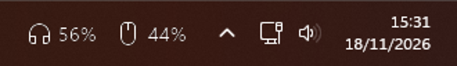

# Bateria dos Periféricos

Mostra na barra de tarefas do Windows 11, ao lado da setinha `^`, o ícone e a porcentagem de bateria dos periféricos sem fio: fone, mouse, controle e teclado.



- Fica sempre visível na barra (não no menu escondido da bandeja).
- Usa os ícones do próprio Windows 11 (Segoe Fluent Icons) e acompanha o tema claro/escuro.
- Número vermelho em 15% ou menos; raiozinho quando está carregando.
- Periférico desligado some sozinho e volta quando liga.
- Some durante jogos e vídeos em tela cheia.
- Arraste para o lado para mudar de lugar. O botão direito abre o menu (Iniciar com o Windows, posição padrão, Sair).

## Periféricos que já funcionam

| Periférico | Como a bateria é lida |
|---|---|
| Qualquer aparelho **Bluetooth** que informe bateria ao Windows (controle Xbox, fones, mouses e teclados BLE) | Propriedade de bateria do próprio Windows |
| Headsets e periféricos **Corsair** | iCUE SDK (o iCUE precisa estar aberto) |
| Mouse **Attack Shark X11** (receptor 2.4G `1D57:FA60`) | Direto do receptor, sem o app da marca |

## Instalação

Requer Windows 11 e Python 3.12.

```bash
pip install -r requirements.txt
python criar_atalho.py
```

Abra o atalho **Bateria Perifericos** (na pasta e no Menu Iniciar).

> Não há `.exe` de propósito: antivírus como o Kaspersky apagam programas Python empacotados com PyInstaller por engano. O atalho roda o script pelo `pythonw.exe` do próprio Python.

## Adaptar para os seus periféricos com o Claude Code

Abra a pasta no Claude Code e peça:

> Adapta esse programa para os meus periféricos: mouse Logitech G Pro X Superlight, headset HyperX Cloud II Wireless. No fim, cria o atalho.

O [`CLAUDE.md`](CLAUDE.md) explica ao Claude como o programa funciona e como descobrir a bateria de cada marca.

## Créditos

- Protocolo do Attack Shark: [Attack Shark Battery KDE](https://gitlab.com/gabriel17166/Attack-Shark-Battery-KDE) (MIT).
- Ícones: fonte Segoe Fluent Icons, que vem com o Windows 11.
